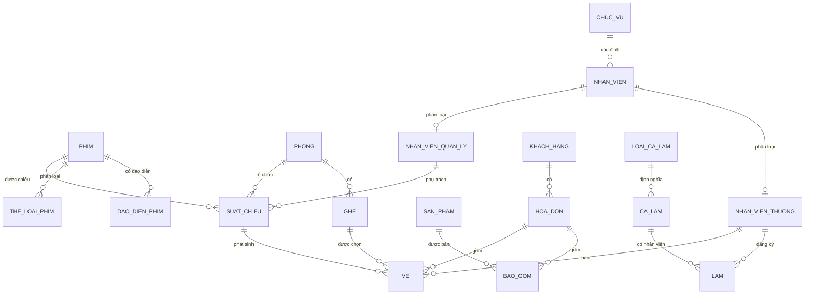
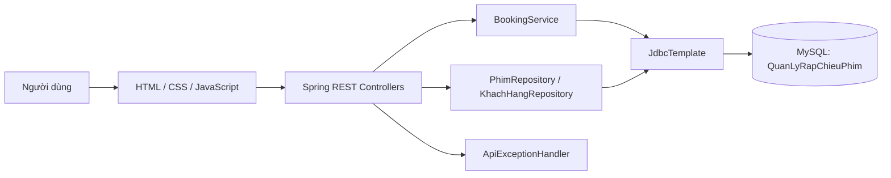
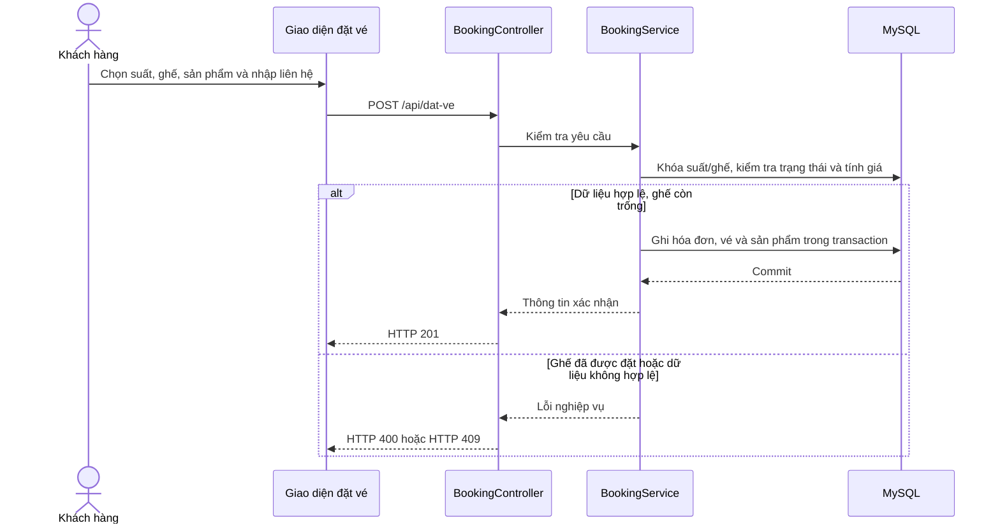

# BÁO CÁO ĐỒ ÁN CƠ SỞ DỮ LIỆU

## HỆ THỐNG QUẢN LÝ RẠP CHIẾU PHIM — PTIT CINEMA

**Nhóm thực hiện:** Nhóm 30  
**Giảng viên hướng dẫn:** [Bổ sung]  
**Sinh viên thực hiện:** [Bổ sung họ tên và mã sinh viên]  
**Lớp:** [Bổ sung]  
**Học viện Công nghệ Bưu chính Viễn thông**

---

## LỜI CẢM ƠN

Nhóm xin trân trọng cảm ơn giảng viên đã hướng dẫn và cung cấp những kiến thức nền tảng về cơ sở dữ liệu trong quá trình thực hiện đề tài. Những kiến thức về mô hình hóa dữ liệu, khóa, ràng buộc toàn vẹn và ngôn ngữ SQL là cơ sở để nhóm phân tích nghiệp vụ và xây dựng hệ thống PTIT Cinema.

Nhóm cũng cảm ơn các thành viên đã phối hợp khảo sát yêu cầu, thiết kế cơ sở dữ liệu, xây dựng ứng dụng và rà soát sản phẩm. Do giới hạn về thời gian và phạm vi của đồ án, báo cáo và chương trình có thể còn thiếu sót; nhóm mong nhận được góp ý để tiếp tục hoàn thiện.

## LỜI NÓI ĐẦU

Hoạt động của một rạp chiếu phim liên quan đến nhiều loại dữ liệu: phim, thể loại, đạo diễn, phòng và ghế, lịch chiếu, nhân viên, khách hàng, hóa đơn, vé và sản phẩm bán kèm. Khi các thông tin này được quản lý rời rạc, việc tra cứu lịch chiếu, xác định ghế còn trống, tổng hợp doanh thu và kiểm soát dữ liệu dễ phát sinh sai lệch.

Đề tài **PTIT Cinema** xây dựng cơ sở dữ liệu quan hệ cho nghiệp vụ quản lý rạp, bổ sung một ứng dụng web Spring Boot để thao tác dữ liệu phim và khách hàng, tra cứu suất chiếu và mô phỏng quy trình đặt vé. Sản phẩm hướng đến mục tiêu học tập: minh họa cách chuyển đổi nghiệp vụ thành mô hình quan hệ, áp dụng khóa và ràng buộc, cũng như truy vấn dữ liệu nhiều bảng bằng MySQL.

Phạm vi báo cáo được tổng hợp từ mã nguồn, hướng dẫn chạy và tập lệnh SQL có trong thư mục dự án. Những chức năng được mô tả là chức năng hiện diện trong mã; các đề xuất kiểm thử hoặc mở rộng được ghi rõ là đề xuất, không được xem là kết quả đã triển khai.

## MỤC LỤC

- [Lời cảm ơn](#lời-cảm-ơn)
- [Lời nói đầu](#lời-nói-đầu)
- [Chương 1. Tổng quan đề tài](#chương-1-tổng-quan-đề-tài)
  - [1.1. Bối cảnh và lý do chọn đề tài](#11-bối-cảnh-và-lý-do-chọn-đề-tài)
  - [1.2. Mục tiêu](#12-mục-tiêu)
  - [1.3. Phạm vi và đối tượng sử dụng](#13-phạm-vi-và-đối-tượng-sử-dụng)
  - [1.4. Yêu cầu chức năng](#14-yêu-cầu-chức-năng)
  - [1.5. Công nghệ sử dụng](#15-công-nghệ-sử-dụng)
- [Chương 2. Phân tích và thiết kế cơ sở dữ liệu](#chương-2-phân-tích-và-thiết-kế-cơ-sở-dữ-liệu)
  - [2.1. Quy trình nghiệp vụ](#21-quy-trình-nghiệp-vụ)
  - [2.2. Mô hình dữ liệu khái quát](#22-mô-hình-dữ-liệu-khái-quát)
  - [2.3. Danh mục bảng và vai trò](#23-danh-mục-bảng-và-vai-trò)
  - [2.4. Khóa và ràng buộc toàn vẹn](#24-khóa-và-ràng-buộc-toàn-vẹn)
  - [2.5. Nhận xét về chuẩn hóa](#25-nhận-xét-về-chuẩn-hóa)
- [Chương 3. Xây dựng và cài đặt hệ thống](#chương-3-xây-dựng-và-cài-đặt-hệ-thống)
  - [3.1. Kiến trúc ứng dụng](#31-kiến-trúc-ứng-dụng)
  - [3.2. Các chức năng giao diện](#32-các-chức-năng-giao-diện)
  - [3.3. Thiết kế API](#33-thiết-kế-api)
  - [3.4. Xử lý nghiệp vụ đặt vé](#34-xử-lý-nghiệp-vụ-đặt-vé)
  - [3.5. Khởi tạo và chạy chương trình](#35-khởi-tạo-và-chạy-chương-trình)
- [Chương 4. Truy vấn, kiểm thử và đánh giá](#chương-4-truy-vấn-kiểm-thử-và-đánh-giá)
  - [4.1. Dữ liệu mẫu](#41-dữ-liệu-mẫu)
  - [4.2. Danh sách truy vấn SQL](#42-danh-sách-truy-vấn-sql)
  - [4.3. Kịch bản kiểm thử đề xuất](#43-kịch-bản-kiểm-thử-đề-xuất)
  - [4.4. Kết quả và giới hạn xác minh](#44-kết-quả-và-giới-hạn-xác-minh)
  - [4.5. Hạn chế hiện tại](#45-hạn-chế-hiện-tại)
- [Chương 5. Kết luận và hướng phát triển](#chương-5-kết-luận-và-hướng-phát-triển)
- [Tài liệu tham khảo](#tài-liệu-tham-khảo)
- [Phụ lục A. Cấu trúc dự án](#phụ-lục-a-cấu-trúc-dự-án)

## DANH MỤC BẢNG

1. [Bảng 1.1. Công nghệ và thành phần](#15-công-nghệ-sử-dụng)
2. [Bảng 2.1. Danh mục 18 bảng dữ liệu](#23-danh-mục-bảng-và-vai-trò)
3. [Bảng 3.1. Các API chính](#33-thiết-kế-api)
4. [Bảng 4.1. Nhóm 13 truy vấn báo cáo](#42-danh-sách-truy-vấn-sql)
5. [Bảng 4.2. Kịch bản kiểm thử đề xuất](#43-kịch-bản-kiểm-thử-đề-xuất)

## DANH MỤC HÌNH

1. [Hình 2.1. Quan hệ dữ liệu nghiệp vụ chính](#22-mô-hình-dữ-liệu-khái-quát)
2. [Hình 3.1. Kiến trúc ứng dụng](#31-kiến-trúc-ứng-dụng)
3. [Hình 3.2. Luồng đặt vé](#34-xử-lý-nghiệp-vụ-đặt-vé)

---

# Chương 1. Tổng quan đề tài

## 1.1. Bối cảnh và lý do chọn đề tài

Một giao dịch tại rạp có thể kết nối nhiều thực thể: khách chọn một phim và suất chiếu, chọn ghế thuộc phòng tương ứng, thanh toán hóa đơn, có thể mua thêm đồ ăn; nhân viên bán vé được ghi nhận trên vé và người quản lý phụ trách suất chiếu. Vì vậy, cơ sở dữ liệu phải vừa biểu diễn được các quan hệ này, vừa bảo đảm những quy tắc như một ghế không được bán hai lần trong cùng một suất.

PTIT Cinema được chọn làm đề tài vì nghiệp vụ đủ gần gũi để khảo sát nhưng có nhiều tình huống quan hệ dữ liệu có giá trị thực hành: quan hệ nhiều-nhiều giữa phim với thể loại/đạo diễn, quan hệ nhân viên với ca làm, tổng hợp hóa đơn và vé, cũng như truy vấn doanh thu theo phim, phòng, nhân viên và thời gian.

## 1.2. Mục tiêu

- Phân tích các dữ liệu cốt lõi trong hoạt động rạp chiếu phim.
- Thiết kế cơ sở dữ liệu quan hệ có khóa chính, khóa ngoại và một số ràng buộc kiểm tra.
- Tạo dữ liệu mẫu đủ để minh họa các truy vấn tổng hợp và truy vấn nhiều bảng.
- Xây dựng ứng dụng web kết nối MySQL để quản lý phim, khách hàng và mô phỏng đặt vé.
- Áp dụng truy vấn SQL cho các câu hỏi quản lý như tình hình suất chiếu, ghế trống, doanh thu, ca làm và sản phẩm bán kèm.

## 1.3. Phạm vi và đối tượng sử dụng

### Phạm vi đã có

1. Cơ sở dữ liệu MySQL tên `QuanLyRapChieuPhim`.
2. Quản lý dữ liệu phim và khách hàng qua API và giao diện web: xem danh sách, tìm kiếm, thêm, sửa và xóa.
3. Tra cứu phim, suất chiếu, phòng, ghế còn/trống và sản phẩm bán kèm trong luồng đặt vé.
4. Tạo hóa đơn, vé và dòng sản phẩm trong một giao dịch cơ sở dữ liệu; phương thức thanh toán được lưu để phục vụ mô phỏng.
5. Tập dữ liệu mẫu và 13 truy vấn SQL phục vụ báo cáo.

### Đối tượng sử dụng trong mô hình

- **Quản lý rạp:** được liên kết với các suất chiếu.
- **Nhân viên bán vé:** được ghi nhận trên từng vé.
- **Khách hàng:** có thể được tìm hoặc tạo mới trong quá trình đặt vé.
- **Người quản trị dữ liệu:** thao tác danh sách phim và khách hàng qua trang quản lý.

Đây là các vai trò nghiệp vụ được mô hình hóa trong dữ liệu. Ứng dụng hiện chưa có màn hình đăng nhập, phân quyền tài khoản hay quy trình xác thực người dùng.

## 1.4. Yêu cầu chức năng

| Mã | Yêu cầu |
|---|---|
| FR-01 | Lưu trữ phim, thể loại và đạo diễn; cho phép tra cứu danh sách phim. |
| FR-02 | Tìm phim theo mã hoặc tên; thêm, cập nhật và xóa thông tin phim qua API. |
| FR-03 | Lưu và tra cứu thông tin khách hàng; tìm theo mã, họ tên, số điện thoại hoặc email. |
| FR-04 | Thêm, cập nhật và xóa khách hàng qua API. |
| FR-05 | Tra cứu danh sách suất chiếu theo phim, phòng, thời gian và số ghế đã đặt. |
| FR-06 | Hiển thị ghế theo phòng/suất chiếu và phân biệt ghế đã đặt, ghế VIP, ghế thường. |
| FR-07 | Chọn ghế và sản phẩm, nhập liên hệ khách hàng, chọn hình thức thanh toán và tạo đơn đặt vé. |
| FR-08 | Tính lại giá ghế và sản phẩm ở backend; từ chối dữ liệu đặt không hợp lệ hoặc ghế vừa được đặt. |
| FR-09 | Cung cấp truy vấn SQL phục vụ các báo cáo vận hành và doanh thu trong dữ liệu mẫu. |

### Yêu cầu phi chức năng chính

- Dữ liệu giao dịch được lưu bằng bảng InnoDB để hỗ trợ transaction và khóa.
- Truy vấn ghi dữ liệu sử dụng tham số thay vì ghép trực tiếp giá trị đầu vào vào câu SQL.
- API trả lỗi dễ nhận biết cho dữ liệu không hợp lệ hoặc xung đột đặt ghế.
- Thông tin kết nối cơ sở dữ liệu có thể cấu hình qua biến môi trường; không đưa mật khẩu thực vào tài liệu.
- Giao diện HTML/CSS/JavaScript tĩnh được phục vụ cùng ứng dụng Spring Boot.

## 1.5. Công nghệ sử dụng

**Bảng 1.1. Công nghệ và thành phần**

| Thành phần | Công nghệ/phiên bản ghi trong dự án | Vai trò |
|---|---|---|
| Ngôn ngữ backend | Java 17 | Xây dựng API và xử lý nghiệp vụ |
| Framework | Spring Boot 3.3.5 | Khởi chạy ứng dụng web và quản lý thành phần |
| Truy cập dữ liệu | Spring JDBC, `JdbcTemplate` | Thực thi truy vấn SQL có tham số |
| Hệ quản trị CSDL | MySQL 8.x (theo hướng dẫn dự án) | Lưu dữ liệu quan hệ |
| Driver | MySQL Connector/J | Kết nối Java với MySQL |
| Giao diện | HTML, CSS, JavaScript | Trang quản lý và trang đặt vé |
| Công cụ build | Maven | Quản lý dependency và đóng gói ứng dụng |
| Môi trường MySQL gợi ý | XAMPP/phpMyAdmin hoặc MySQL Workbench | Khởi động MySQL và nhập tập lệnh SQL |

# Chương 2. Phân tích và thiết kế cơ sở dữ liệu

## 2.1. Quy trình nghiệp vụ

### Quy trình quản lý dữ liệu

Người quản lý mở trang dữ liệu, nhập từ khóa hoặc điền biểu mẫu phim/khách hàng. Trình duyệt gửi yêu cầu HTTP đến REST API. Controller nhận yêu cầu, repository dùng `JdbcTemplate` đọc hoặc ghi dữ liệu MySQL, sau đó kết quả được trả về để giao diện cập nhật danh sách.

### Quy trình đặt vé

1. Giao diện tải danh sách phim có suất chiếu.
2. Người dùng chọn phim; giao diện tải các suất chiếu tương ứng.
3. Khi chọn suất, ứng dụng tải sơ đồ ghế và trạng thái ghế.
4. Người dùng chọn một hoặc nhiều ghế, chọn sản phẩm tùy chọn, nhập họ tên/số điện thoại/email và chọn tiền mặt hoặc chuyển khoản.
5. Backend kiểm tra dữ liệu, tra lại ghế và giá từ cơ sở dữ liệu, tìm hoặc tạo khách hàng rồi ghi hóa đơn, vé và sản phẩm.
6. Nếu thao tác ghi thất bại, transaction bị hủy; nếu ghế đã được người khác đặt, API trả xung đột để giao diện thông báo chọn lại.

## 2.2. Mô hình dữ liệu khái quát

Mô hình có 18 bảng. Các bảng nối `TheLoaiPhim` và `DaoDienPhim` giải quyết quan hệ nhiều-nhiều giữa phim với thể loại/đạo diễn. Bảng `Ve` gắn ghế với suất chiếu, hóa đơn và nhân viên bán vé. Bảng `BaoGom` thể hiện sản phẩm/số lượng trên hóa đơn.

**Hình 2.1. Quan hệ dữ liệu nghiệp vụ chính**



Sơ đồ tập trung vào các quan hệ cốt lõi; khóa ngoại cụ thể và các bảng phụ trợ được thể hiện trong tập lệnh [database/database.sql](./database/database.sql).

## 2.3. Danh mục bảng và vai trò

**Bảng 2.1. Danh mục 18 bảng dữ liệu**

| STT | Bảng | Khóa chính | Vai trò |
|---:|---|---|---|
| 1 | `Phim` | `MaPhim` | Thông tin, thời lượng, ngày khởi chiếu và doanh thu tham khảo của phim |
| 2 | `TheLoaiPhim` | (`TheLoai`, `MaPhim`) | Liên kết phim với một hoặc nhiều thể loại |
| 3 | `DaoDienPhim` | (`DaoDien`, `MaPhim`) | Liên kết phim với đạo diễn |
| 4 | `Phong` | `MaPhong` | Tên, loại, tầng và sức chứa phòng chiếu |
| 5 | `Ghe` | (`MaGhe`, `MaPhong`) | Ghế, hàng ghế và loại ghế trong phòng |
| 6 | `SanPham` | `MaSanPham` | Đồ ăn/uống bán kèm và đơn giá |
| 7 | `KhachHang` | `MaKhachHang` | Thông tin liên hệ khách hàng |
| 8 | `ChucVu` | `MaChucVu` | Danh mục chức vụ nhân viên |
| 9 | `NhanVien` | `MaNhanVien` | Thông tin nhân viên và chức vụ |
| 10 | `NhanVienQuanLy` | `MaQuanLy` | Thông tin riêng của nhân viên quản lý |
| 11 | `NhanVienThuong` | `MaNVThuong` | Thông tin riêng của nhân viên bán vé/nhân viên thường |
| 12 | `LoaiCaLam` | `MaLoaiCaLam` | Khung giờ bắt đầu và kết thúc của loại ca |
| 13 | `CaLam` | `MaCaLam` | Ca làm cụ thể theo ngày |
| 14 | `Lam` | (`MaNV`, `MaCaLam`) | Liên kết nhân viên thường với ca làm |
| 15 | `SuatChieu` | `MaSuatChieu` | Phim, phòng, ngày/giờ và quản lý phụ trách suất |
| 16 | `HoaDon` | `MaHoaDon` | Khách hàng, thời điểm, hình thức thanh toán và thành tiền |
| 17 | `BaoGom` | (`MaHoaDon`, `MaSanPham`) | Sản phẩm và số lượng trên hóa đơn |
| 18 | `Ve` | `MaVe` | Giá vé, ghế, suất chiếu, hóa đơn và nhân viên bán |

### Một số lựa chọn mô hình đáng chú ý

- Ghế có khóa chính ghép với phòng vì mã ghế như `A01` có thể lặp lại ở các phòng khác nhau.
- Vé lưu cả suất chiếu và phòng; cặp (`MaSuatChieu`, `MaPhong`) tham chiếu suất chiếu để bảo đảm phòng của vé khớp với phòng của suất.
- Bảng `Ve` có ràng buộc duy nhất trên (`MaSuatChieu`, `MaGhe`, `MaPhong`), ngăn cùng một ghế bị bán hai lần trong cùng suất.
- `TheLoaiPhim`, `DaoDienPhim`, `Lam` và `BaoGom` là các bảng liên kết, đồng thời có thể lưu thuộc tính của quan hệ như số lượng trong `BaoGom`.
- `NhanVienQuanLy` và `NhanVienThuong` tách các thuộc tính đặc thù như lương cứng và lương theo giờ khỏi thông tin chung trong `NhanVien`.

## 2.4. Khóa và ràng buộc toàn vẹn

Tập lệnh SQL dùng khóa chính cho các định danh; khóa ngoại thể hiện quan hệ và có hành động `ON DELETE`/`ON UPDATE` phù hợp. Các ràng buộc đáng chú ý gồm:

- `SanPham.Gia`, lương, giá vé và thành tiền không âm.
- `BaoGom.SoLuong` lớn hơn 0.
- Giờ bắt đầu của ca và suất chiếu phải nhỏ hơn giờ kết thúc.
- Hình thức thanh toán thuộc một trong hai giá trị `Tiền mặt` hoặc `Chuyển khoản`.
- Email khách hàng/nhân viên phải chứa ký tự `@` theo kiểm tra đơn giản tại CSDL.
- Sức chứa phòng được lưu cùng thông tin phòng; dữ liệu mẫu hiện có 10 ghế mỗi phòng.
- Vé duy nhất theo suất, ghế và phòng.

Các ràng buộc dữ liệu thực tế có thể mở rộng thêm: định dạng email đầy đủ, chuẩn hóa số điện thoại, giờ chiếu qua đêm, giới hạn số ghế theo sức chứa và quy tắc giá theo ngày/phim. CHECK hỗ trợ cụ thể còn tùy phiên bản MySQL được dùng.

## 2.5. Nhận xét về chuẩn hóa

Thiết kế tách các nhóm dữ liệu độc lập thành các bảng riêng: phim, phòng, ghế, nhân viên, khách hàng, sản phẩm, hóa đơn và suất chiếu. Các quan hệ nhiều-nhiều được tách thành bảng liên kết; vì vậy hạn chế việc lặp danh sách thể loại/đạo diễn trong một ô hoặc lặp thông tin phim trên từng vé.

Các bảng nối dùng khóa ghép để hạn chế trùng cặp quan hệ. `BaoGom` giữ số lượng sản phẩm theo từng hóa đơn và sản phẩm thay vì lưu danh sách sản phẩm dạng chuỗi. Đây là các lựa chọn phù hợp với nguyên tắc 1NF và giảm phụ thuộc không cần thiết.

Báo cáo không khẳng định đã có tài liệu chứng minh hình thức từng phụ thuộc hàm và từng bước phân rã đến 3NF. Nếu yêu cầu chấm điểm cần chứng minh chuẩn hóa, nhóm nên bổ sung bảng phụ thuộc hàm, khóa ứng viên và lập luận riêng cho từng quan hệ dựa trên quy tắc nghiệp vụ.

# Chương 3. Xây dựng và cài đặt hệ thống

## 3.1. Kiến trúc ứng dụng

Ứng dụng dùng một tiến trình Spring Boot phục vụ REST API và các trang tĩnh. Backend chia theo các thành phần `controller`, `service`, `repository` và `model`; các repository/service truy vấn MySQL bằng `JdbcTemplate`.

**Hình 3.1. Kiến trúc ứng dụng**



Trong luồng quản lý phim/khách hàng, controller gọi repository. Trong luồng đặt vé, controller gọi `BookingService` để gom kiểm tra và ghi nhiều bảng vào một transaction. `ApiExceptionHandler` ánh xạ lỗi dữ liệu thành phản hồi HTTP.

## 3.2. Các chức năng giao diện

### Trang quản lý dữ liệu

Trang `Database.html` trình bày danh sách phim và khách hàng. Giao diện hỗ trợ tìm kiếm, biểu mẫu thêm/sửa, thao tác xóa và tải lại danh sách sau thao tác. Trang gọi các API `/api/phim` và `/api/khach-hang`.

### Trang đặt vé

Trang `DatVe.html` tổ chức thao tác thành các bước: chọn phim/suất, chọn ghế, chọn đồ ăn, nhập thông tin khách hàng, chọn hình thức thanh toán và xem xác nhận. Ghế đã đặt bị vô hiệu hóa khi giao diện hiển thị; tuy vậy backend vẫn kiểm tra lại để bảo vệ dữ liệu trước các yêu cầu đồng thời hoặc dữ liệu bị sửa ở trình duyệt.

Giao diện có ghi chú thanh toán đang mô phỏng. Dự án không tích hợp ngân hàng, cổng thanh toán hay thu tiền thật.

## 3.3. Thiết kế API

**Bảng 3.1. Các API chính**

| Phương thức | Đường dẫn | Chức năng |
|---|---|---|
| `GET` | `/api/phim` | Lấy danh sách phim |
| `GET` | `/api/phim?q={từ_khóa}` | Tìm phim theo mã hoặc tên |
| `POST` | `/api/phim` | Thêm phim |
| `PUT` | `/api/phim/{id}` | Cập nhật phim |
| `DELETE` | `/api/phim/{id}` | Xóa phim |
| `GET` | `/api/khach-hang` | Lấy danh sách khách hàng |
| `GET` | `/api/khach-hang?q={từ_khóa}` | Tìm theo mã, tên, số điện thoại hoặc email |
| `POST` | `/api/khach-hang` | Thêm khách hàng |
| `PUT` | `/api/khach-hang/{id}` | Cập nhật khách hàng |
| `DELETE` | `/api/khach-hang/{id}` | Xóa khách hàng |
| `GET` | `/api/dat-ve/phim` | Lấy phim có suất chiếu |
| `GET` | `/api/dat-ve/suat-chieu?maPhim={id}` | Tra cứu suất chiếu, có thể lọc theo phim |
| `GET` | `/api/dat-ve/suat-chieu/{id}/ghe` | Lấy ghế và trạng thái đặt của một suất |
| `GET` | `/api/dat-ve/do-an` | Lấy danh mục sản phẩm |
| `POST` | `/api/dat-ve` | Tạo hóa đơn, vé và chi tiết đồ ăn |

API tạo đặt vé nhận mã suất chiếu, danh sách ghế, danh sách sản phẩm/số lượng, thông tin khách hàng và hình thức thanh toán. Phản hồi thành công chứa mã hóa đơn, phim, lịch chiếu, phòng, ghế và tổng tiền. Lỗi đầu vào trả HTTP 400; xung đột ghế trả HTTP 409.

## 3.4. Xử lý nghiệp vụ đặt vé

Backend không tin giá gửi từ trình duyệt. Giá được xác định từ dữ liệu ghế/sản phẩm và quy tắc trong service: ghế thường 100.000 đồng, ghế VIP 50.000 đồng; giá sản phẩm lấy từ bảng `SanPham`.

**Hình 3.2. Luồng đặt vé**



Các kiểm tra quan trọng trong service:

- Phải chọn suất chiếu tồn tại và từ 1 đến 10 ghế.
- Không chấp nhận mã ghế lặp, ghế không thuộc phòng hoặc ghế đã có vé ở đúng suất chiếu.
- Mỗi món có số lượng từ 1 đến 20; một mã sản phẩm chỉ xuất hiện một lần trong danh sách đơn.
- Họ tên và số điện thoại là bắt buộc; email nếu nhập phải có ký tự `@`.
- Phương thức thanh toán chỉ nhận tiền mặt hoặc chuyển khoản.
- Hóa đơn, vé và dòng sản phẩm được ghi trong cùng một transaction; ràng buộc duy nhất ở bảng `Ve` là lớp bảo vệ bổ sung trước việc bán trùng.

## 3.5. Khởi tạo và chạy chương trình

### Điều kiện

- Java 17 trở lên.
- Maven 3.9 trở lên theo README của dự án.
- MySQL 8.x; có thể khởi động qua XAMPP nếu đã cài đặt.

### Các bước

1. Khởi động MySQL.
2. Nhập `database/database.sql` bằng MySQL Workbench hoặc phpMyAdmin.
3. Kiểm tra cấu hình kết nối trong `src/main/resources/application.properties`. Mặc định ứng dụng kết nối `localhost:3306/QuanLyRapChieuPhim`; username/password có thể đặt qua `DB_USERNAME` và `DB_PASSWORD`.
4. Tại thư mục dự án chạy:

   ```bash
   mvn spring-boot:run
   ```

5. Mở `http://localhost:8080/` hoặc `http://localhost:8080/Database.html` để quản lý dữ liệu; mở `http://localhost:8080/DatVe.html` để thử luồng đặt vé.
6. Dừng ứng dụng bằng `Ctrl+C` tại terminal đang chạy Spring Boot.

**Cảnh báo dữ liệu:** `database/database.sql` có lệnh `DROP DATABASE IF EXISTS QuanLyRapChieuPhim`. Nhập lại toàn bộ tập lệnh sẽ xóa database cùng tên trước khi tạo mới. Cần sao lưu dữ liệu trước khi chạy trên môi trường có dữ liệu cần giữ.

# Chương 4. Truy vấn, kiểm thử và đánh giá

## 4.1. Dữ liệu mẫu

Tập lệnh SQL tạo dữ liệu mẫu có chủ đích để các truy vấn báo cáo có tình huống phù hợp, gồm:

- 6 phim, trong đó có phim hành động, kinh dị, hoạt hình và khoa học viễn tưởng.
- 3 phòng chiếu, mỗi phòng có 10 ghế; ghế thường và VIP được phân biệt.
- 4 sản phẩm bán kèm.
- 5 khách hàng và 5 nhân viên; nhân viên được chia thành quản lý và nhân viên thường.
- 11 suất chiếu, 12 hóa đơn và 23 vé trong khoảng thời gian cuối tháng 11 đến đầu tháng 12 năm 2024.
- Các tình huống mẫu như khách mua vé ở cả hai tháng, cặp đạo diễn làm chung nhiều phim và có suất chiếu buổi sáng.

Đây là dữ liệu minh họa cho đồ án, không phải dữ liệu vận hành hiện tại. Lịch chiếu mẫu năm 2024 đã qua và cần cập nhật trước khi dùng thử như lịch đặt vé thực tế.

## 4.2. Danh sách truy vấn SQL

`database/database.sql` chứa 13 truy vấn đã được chú thích theo mục tiêu. Các truy vấn bao phủ:

**Bảng 4.1. Nhóm 13 truy vấn báo cáo**

| STT | Nội dung |
|---:|---|
| 1 | Liệt kê suất chiếu ngày 26/11/2024 kèm phòng, phim, đạo diễn và thể loại |
| 2 | Tìm suất do quản lý Lê Văn Tài phụ trách có doanh thu vé cao nhất trong khoảng thời gian mẫu |
| 3 | Liệt kê ghế trống theo suất chiếu ngày 25/11/2024 |
| 4 | Tính số vé và doanh thu từng phòng; chỉ lấy phòng bán trên 3 vé |
| 5 | Tìm cặp đạo diễn cùng tham gia ít nhất hai phim |
| 6 | Tính tổng giờ làm và tiền lương nhân viên theo giờ |
| 7 | Tính doanh số vé của nhân viên họ Trần trong tháng 11/2024 |
| 8 | Tìm khách hàng trên 20 tuổi có tổng hóa đơn tháng 11 lớn hơn 200.000 đồng |
| 9 | Tìm khách mua vé cả tháng 11 và tháng 12/2024 |
| 10 | Tìm khách xem *Avengers: Endgame* nhưng chưa xem *Us* |
| 11 | Tìm phim hành động có doanh số vé cao nhất trong ngày 30/11–01/12 |
| 12 | Tìm phim có giá trị vé thanh toán chuyển khoản cao hơn tiền mặt trong khoảng đã chọn |
| 13 | Tìm sản phẩm bán chạy nhất trên hóa đơn có vé của suất chiếu buổi sáng |

Một số điểm hiệu chỉnh đã ghi trong README: giới hạn kết quả truy vấn doanh thu lớn nhất; kiểm tra ghế theo đúng suất chiếu; tránh nhân doanh thu khi hóa đơn có nhiều vé; cố định mốc tính tuổi để kết quả báo cáo ổn định; và làm rõ khoảng thời gian truy vấn. Các truy vấn dùng mốc năm 2024 để tương thích dữ liệu mẫu, vì vậy cần đổi tham số ngày khi áp dụng cho kỳ báo cáo khác.

## 4.3. Kịch bản kiểm thử đề xuất

**Bảng 4.2. Kịch bản kiểm thử đề xuất**

| Mã | Kịch bản | Kết quả mong đợi |
|---|---|---|
| TC-01 | Nhập SQL trên một database thử nghiệm mới | Tạo đủ 18 bảng và nạp dữ liệu mẫu; các khóa ngoại hợp lệ |
| TC-02 | Gọi `GET /api/phim` và tìm theo tên/mã | Trả danh sách hoặc tập kết quả khớp từ khóa |
| TC-03 | Thêm, sửa, xóa một phim/khách hàng thử | Dữ liệu được lưu; mã không tồn tại khi sửa/xóa trả 404 |
| TC-04 | Tạo đơn với suất và ghế hợp lệ | Tạo một hóa đơn, mỗi vé tương ứng một ghế; tổng tiền khớp giá backend |
| TC-05 | Đặt lại ghế đã bán trong cùng suất | Bị từ chối với HTTP 409; không phát sinh hóa đơn/vé dở dang |
| TC-06 | Gửi ghế không thuộc phòng hoặc gửi trùng mã ghế | Bị từ chối; không thay đổi dữ liệu |
| TC-07 | Gửi số lượng sản phẩm bằng 0, trên 20 hoặc mã sản phẩm không tồn tại | Bị từ chối; transaction không ghi một phần đơn |
| TC-08 | Gửi thiếu số điện thoại, phương thức thanh toán sai hoặc email không hợp lệ | Trả lỗi đầu vào HTTP 400 |
| TC-09 | Hai yêu cầu đồng thời đặt cùng một ghế | Chỉ một yêu cầu thành công; yêu cầu còn lại nhận xung đột |
| TC-10 | Chạy lần lượt 13 truy vấn trên dữ liệu mẫu | Kết quả phù hợp điều kiện và khoảng thời gian mô tả trong từng truy vấn |

Các mục trên là kế hoạch kiểm thử dựa trên mã nguồn và ràng buộc dữ liệu. Chúng không phải bằng chứng rằng toàn bộ kịch bản đã được chạy thành công.

## 4.4. Kết quả và giới hạn xác minh

Qua rà soát cấu trúc dự án, có thể xác nhận các thành phần triển khai hiện diện gồm tập lệnh SQL, REST controller, repository, service đặt vé và hai trang HTML. Tập lệnh có phần tạo bảng, dữ liệu mẫu, 13 truy vấn và các truy vấn đếm nhanh.

Trong thư mục nguồn đã kiểm tra không thấy thư mục hoặc lớp kiểm thử tự động. Báo cáo này không ghi nhận kết quả chạy MySQL, kiểm thử giao diện trên trình duyệt hay chạy 13 truy vấn tại một máy chủ CSDL. Vì vậy các kịch bản ở mục 4.3 cần được thực thi để có biên bản kiểm thử và ảnh chụp kết quả trước khi nộp nếu yêu cầu môn học cần minh chứng chạy chương trình.

## 4.5. Hạn chế hiện tại

1. **Phạm vi CRUD trên giao diện còn giới hạn:** giao diện quản lý hiện tập trung vào phim và khách hàng; các bảng nhân viên, phòng, ghế, suất chiếu, hóa đơn và sản phẩm chưa có màn hình CRUD.
2. **Chưa có đăng nhập và phân quyền:** các API không gắn với tài khoản hay vai trò người dùng.
3. **Thanh toán chỉ mô phỏng:** không kết nối cổng thanh toán và không xác nhận giao dịch ngân hàng.
4. **Dữ liệu lịch chiếu đã cũ:** mẫu sử dụng ngày trong năm 2024 và giao diện hiển thị dữ liệu theo đúng CSDL, không tự ẩn suất đã qua.
5. **Giá vé là quy tắc cố định:** giá ghế thường/VIP được đặt trong service; chưa có bảng cấu hình giá theo suất, loại phòng, ngày hoặc chương trình ưu đãi.
6. **Quy tắc sức chứa chưa đồng bộ tự động:** dữ liệu sức chứa phòng và số ghế thực tế có thể sai khác nếu không được kiểm soát khi nhập dữ liệu.
7. **Kiểm thử tự động chưa được thể hiện trong mã nguồn đã rà soát:** cần bổ sung test cho repository, service, API và cạnh tranh đặt ghế.
8. **Chưa có phân trang và báo cáo trên giao diện:** truy vấn SQL mẫu phục vụ thực hành nhưng chưa được đóng gói thành màn hình báo cáo có bộ lọc thời gian.

# Chương 5. Kết luận và hướng phát triển

Đề tài PTIT Cinema đã xây dựng được mô hình dữ liệu tương đối đầy đủ cho các nghiệp vụ chính của rạp chiếu phim: quản lý phim, lịch chiếu, phòng/ghế, nhân viên, khách hàng, hóa đơn, vé và sản phẩm bán kèm. Tập lệnh MySQL thể hiện khóa chính, khóa ngoại, khóa ghép và các ràng buộc cơ bản; dữ liệu mẫu hỗ trợ 13 truy vấn tổng hợp theo nhiều chiều.

Ứng dụng Spring Boot bổ sung khả năng quản lý phim và khách hàng qua API, đồng thời cung cấp luồng đặt vé minh họa. Điểm đáng chú ý của luồng đặt vé là backend tự xác định giá, kiểm tra ghế theo suất chiếu, dùng transaction khi tạo các bản ghi liên quan và dựa thêm vào ràng buộc duy nhất để hạn chế bán trùng ghế.

Để phát triển thành sản phẩm gần với vận hành thực tế, nhóm nên ưu tiên bổ sung xác thực/phân quyền, cập nhật và lọc lịch chiếu tương lai, cấu hình giá, quản lý các danh mục còn thiếu, tích hợp cổng thanh toán trong môi trường thử nghiệm, bổ sung kiểm thử tự động và tạo giao diện báo cáo có bộ lọc thời gian. Trước khi mở rộng, cần sao lưu và rà soát kỹ tập lệnh khởi tạo vì script hiện xóa database cùng tên trước khi tạo lại.

# Tài liệu tham khảo

1. Tập lệnh cơ sở dữ liệu và truy vấn mẫu của dự án: [`database/database.sql`](./database/database.sql).
2. Tài liệu giới thiệu và hướng dẫn chạy dự án: [`README.md`](./README.md), [`HUONG_DAN_CHAY.txt`](./HUONG_DAN_CHAY.txt).
3. Tệp cấu hình Maven: [`pom.xml`](./pom.xml).
4. Mã nguồn ứng dụng trong `src/main/java/com/ptit/cinema/` và giao diện tại `src/main/resources/static/`.
5. Video tham khảo mục lục báo cáo do người dùng cung cấp; cấu trúc chương trong báo cáo này được điều chỉnh theo phạm vi thực tế của PTIT Cinema.

# Phụ lục A. Cấu trúc dự án

```text
PTIT_Cinema_Project/
├── database/
│   └── database.sql
├── src/
│   └── main/
│       ├── java/com/ptit/cinema/
│       │   ├── controller/
│       │   ├── model/
│       │   ├── repository/
│       │   └── service/
│       └── resources/
│           ├── application.properties
│           └── static/
│               ├── Database.html
│               ├── DatVe.html
│               └── index.html
├── HUONG_DAN_CHAY.txt
├── pom.xml
└── README.md
```
